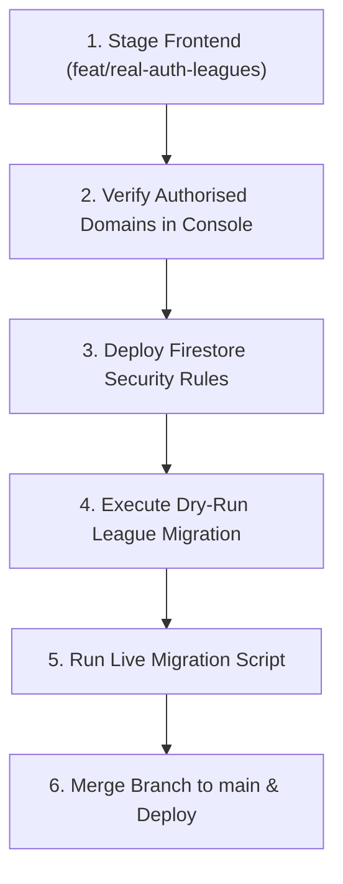

# Bet Buddy: Firebase Authentication & Security Rules Rollout Plan

This document outlines the **manual steps** required in the Firebase and Google Cloud consoles to complete the rollout of real Firebase Authentication, handle reservations, and UID-keyed leagues.

> [!NOTE]
> Authentication providers (**Google** and **Email/Password**) are already enabled in project `betbuddyuk`. Do not re-configure them.

---

## 1. Manual Steps in Firebase & Google Cloud Consoles

### 1.1 Authorised Domains
1. Open the **Firebase Console** &rarr; Project **`betbuddyuk`** &rarr; **Authentication** &rarr; **Settings** &rarr; **Authorized domains**.
2. Verify or add each of the following domains:
   - `betbuddyuk.uk`
   - `www.betbuddyuk.uk`
   - `martinwhite-dev.github.io` (GitHub Pages host)
   - `match-iq.vercel.app` (or your active Vercel preview/production domain)
   - `localhost` (default)
3. *Why*: If a domain is missing, Google OAuth popup and email verification links fail with `auth/unauthorized-domain`.

### 1.2 Customise Email Templates
1. Open **Authentication** &rarr; **Templates**.
2. **Email address verification**:
   - Sender name: `Bet Buddy UK`
   - Subject: `Verify your email for Bet Buddy UK ⚽`
   - Customise body to match British English phrasing and remind users that verification unlocks private Buddy Leagues.
3. **Password reset**:
   - Sender name: `Bet Buddy UK`
   - Subject: `Reset your Bet Buddy UK password`
4. Tap **Save** on each template.

### 1.3 Google Cloud Trial Budget Alert
1. The current Blaze trial is active through **29 January 2027**.
2. Open **Google Cloud Console** &rarr; **Billing** &rarr; **Budgets & alerts**.
3. Create a budget for project `betbuddyuk`:
   - Target amount: **£1.00** (or your chosen threshold).
   - Trigger alerts at 50%, 90%, and 100%.
   - Email recipient: Project owners (`octopigardens@gmail.com`).
4. *Why*: Guarantees zero surprise charges if usage spikes or when the trial period ends.

### 1.4 Firebase App Check (Recommended Pre-Launch)
1. Open **App Check** in Firebase Console.
2. Register your web app with **reCAPTCHA Enterprise** or **reCAPTCHA v3**.
3. Enforce Firestore App Check only after production traffic confirms valid tokens.

---

## 2. Security Rules Verification & Deployment

The new [`firestore.rules`](file:///c:/Users/headp/MatchIQ/firestore.rules) file enforces default-deny, owner-only diary isolation, case-insensitive handle reservation, and verified-email gates for leagues.

### 2.1 Emulator Testing Note
- Rule unit tests are located in [`tests/rules/firestore.test.js`](file:///c:/Users/headp/MatchIQ/tests/rules/firestore.test.js).
- Running the Firestore Emulator (`firebase emulators:exec`) requires a local **Java 11+ Runtime (JRE/JDK)**.
- Once Java is installed:
  ```bash
  cd tests/rules
  npm test
  ```

### 2.2 Publishing Live Rules (Approval Required)
> [!IMPORTANT]
> **DO NOT** deploy rules until the frontend branch has been merged and tested on staging.
To deploy rules manually:
```bash
firebase.cmd deploy --only firestore:rules
```

---

## 3. Ordered Rollout Sequence



1. **Step 1 (Preview Testing)**:
   - Deploy `feat/real-auth-leagues` to Vercel preview or local environment with `?emulator=1`.
   - Test Google Sign-in popup, Email registration, verification email receipt, and password reset.
2. **Step 2 (Domain Check)**:
   - Verify no `auth/unauthorized-domain` console errors on test domains.
3. **Step 3 (Rules Publication)**:
   - Run `firebase.cmd deploy --only firestore:rules`.
4. **Step 4 (Database Migration)**:
   - Run `node scripts/migrate_leagues.js --dry-run` to inspect existing records.
   - Run `node scripts/migrate_leagues.js --execute` to write the subcollections.
5. **Step 5 (Production Release)**:
   - Merge `feat/real-auth-leagues` into `main`. GitHub Actions & Vercel will ship the updated zero-build bundle.

---

## 4. Rollback Plan

If an unexpected regression occurs in production:
1. **Frontend Rollback**:
   - Revert the commit on `main` or switch Vercel production deployment to the previous instant deployment hash.
2. **Rules Rollback**:
   - Open Firebase Console &rarr; Firestore &rarr; Rules &rarr; **Rules history**.
   - Select the previous rules version and click **Publish**.
3. **Data Rollback**:
   - Run `node scripts/migrate_leagues.js --rollback --execute`.
   - Restores legacy `members` map from `_legacyMembersBackup`.

